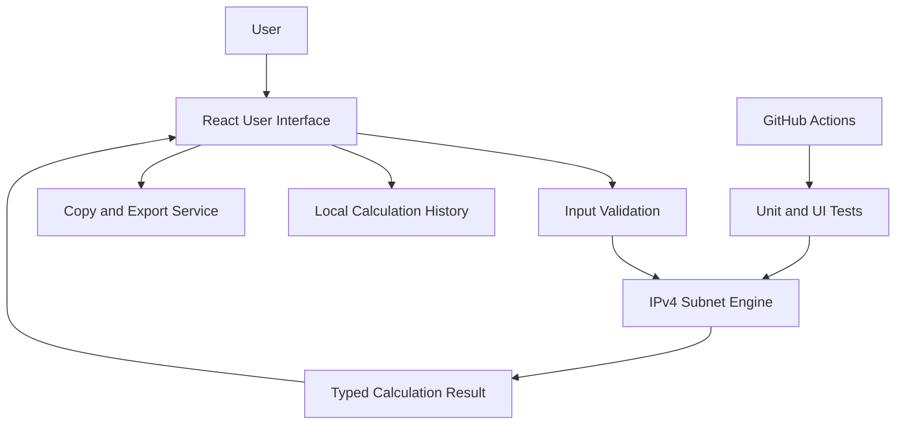

# IP Subnet Calculator
## Full Architecture and Implementation Plan

**Project type:** Networking / Web Application  
**Level:** Portfolio-ready, with room for advanced features  
**Primary goal:** Build a reliable IPv4 subnet calculator that helps students, network engineers, and IT support teams calculate subnet details, plan address allocation, and document network designs.

---

## 1. Project Overview

The IP Subnet Calculator accepts an IPv4 address with a CIDR prefix (for example, `192.168.10.25/24`) and calculates the network details associated with that address and prefix.

The application should provide:
- IPv4 address and CIDR validation.
- Network address and broadcast address.
- Subnet mask and wildcard mask.
- Total addresses and usable host count.
- First and last usable host addresses.
- Network and host portions in binary.
- CIDR-to-subnet-mask and subnet-mask-to-CIDR conversion.
- Subnet splitting and VLSM planning.
- Address-range and overlap checks.
- Copy, export, and calculation history features.
- Responsive interface and automated tests.

**Important:** Calculations should be based on integer/bitwise IPv4 arithmetic, not string-only guesses. The implementation must explicitly handle `/0`, `/31`, and `/32`.

## 2. Goals and Non-Goals

### Goals
1. Produce correct, deterministic IPv4 subnet calculations.
2. Explain results in a way that supports learning and practical network planning.
3. Keep calculation logic independent from the user interface.
4. Validate user input and display actionable error messages.
5. Make the project easy to test, extend, deploy, and review on GitHub.

### Initial non-goals
- IPv6 calculations in the first release.
- Scanning networks or probing live hosts.
- Automatically changing router or switch configurations.
- Replacing an IP address management (IPAM) platform.
- Storing user data on a server unless a future version explicitly adds accounts or cloud sync.

---

## 3. Recommended Technology Stack

Use a simple stack that is easy to maintain and demonstrate.

| Layer | Recommended technology | Responsibility |
|---|---|---|
| Frontend | React + TypeScript + Vite | UI, forms, results, history |
| Styling | CSS Modules or plain CSS | Responsive layout and accessible styling |
| Validation | Zod or a small typed validation module | Input and request validation |
| Calculation engine | Pure TypeScript module | All IPv4/CIDR calculations |
| Unit tests | Vitest | Validate calculation edge cases |
| UI tests | React Testing Library | Test forms and result rendering |
| End-to-end tests | Playwright (optional) | Test complete user workflows |
| Formatting | Prettier | Consistent formatting |
| Linting | ESLint | Catch common code issues |
| CI | GitHub Actions | Run lint, type checks, and tests |
| Deployment | GitHub Pages, Cloudflare Pages, or Vercel | Host the static frontend |

### Architecture decision
For the first version, calculate everything in the browser. A backend is not required because the calculation is local, deterministic, and does not need private data or a database. This reduces cost, setup complexity, and security exposure.

A future API can be added if there is a genuine need for integrations or shared network plans.

---

## 4. High-Level Architecture



### Component responsibilities

1. **User interface:** Collects an IPv4 address and CIDR prefix; presents results.
2. **Input validation:** Rejects malformed IPv4 addresses, invalid prefixes, and invalid subnet masks before calculation.
3. **Subnet engine:** Converts addresses to 32-bit integers and calculates network properties using masks and bitwise operations.
4. **Result model:** Returns a consistent typed object for the UI, export functions, and tests.
5. **History module:** Saves recent calculations locally, with clear and delete actions.
6. **Export module:** Copies a summary and downloads a CSV or JSON file.
7. **Test suite:** Verifies mathematical correctness and edge cases.
8. **CI workflow:** Runs checks for every pull request and push to the main branch.

---

## 5. Repository Structure

```text
ip-subnet-calculator/
├── public/
│   └── favicon.svg
├── src/
│   ├── app/
│   │   ├── App.tsx
│   │   └── app.css
│   ├── components/
│   │   ├── AddressInput.tsx
│   │   ├── SubnetResult.tsx
│   │   ├── ResultTable.tsx
│   │   ├── BinaryView.tsx
│   │   ├── SubnetSplitter.tsx
│   │   ├── VlsmPlanner.tsx
│   │   ├── HistoryPanel.tsx
│   │   └── ExportControls.tsx
│   ├── features/
│   │   ├── calculator/
│   │   │   ├── ipv4.ts
│   │   │   ├── subnet.ts
│   │   │   ├── subnet-mask.ts
│   │   │   ├── vlsm.ts
│   │   │   └── types.ts
│   │   ├── history/
│   │   │   └── history-storage.ts
│   │   └── export/
│   │       └── export-results.ts
│   ├── lib/
│   │   ├── validation.ts
│   │   └── format.ts
│   ├── test/
│   │   ├── ipv4.test.ts
│   │   ├── subnet.test.ts
│   │   ├── subnet-mask.test.ts
│   │   ├── vlsm.test.ts
│   │   └── validation.test.ts
│   ├── main.tsx
│   └── vite-env.d.ts
├── docs/
│   ├── ARCHITECTURE.md
│   ├── CALCULATION-LOGIC.md
│   ├── TEST-PLAN.md
│   └── screenshots/
├── .github/
│   └── workflows/
│       └── ci.yml
├── .gitignore
├── LICENSE
├── package.json
├── tsconfig.json
├── vite.config.ts
└── README.md
```

The exact file structure can be adjusted as the application grows. Keep the calculation engine separate from React components.

---

## 6. Core IPv4 Calculation Logic

### 6.1 Input format

Support either:
- Address and prefix fields separately: `192.168.10.25` and `24`.
- A combined CIDR field: `192.168.10.25/24`.

For the first release, use strict dotted-decimal IPv4 notation and prefix lengths from `0` to `32`.

### 6.2 Validation rules

- IPv4 must contain exactly four decimal octets.
- Each octet must be between `0` and `255`.
- Reject missing octets, extra octets, negative values, and values greater than `255`.
- Prefix length must be an integer from `0` through `32`.
- Do not silently convert malformed input.
- Trim surrounding whitespace.
- Show a readable error message near the relevant field.
- If subnet-mask input is supported, ensure the mask consists of contiguous `1` bits followed by contiguous `0` bits.

### 6.3 Main calculations

Let:
- `IP` be the unsigned 32-bit integer for the input address.
- `p` be the prefix length, from `0` through `32`.
- `mask` be the 32-bit subnet mask.
- `network` be the network address.
- `broadcast` be the broadcast address.

For `p > 0`:

```text
mask = (0xFFFFFFFF << (32 - p)) AND 0xFFFFFFFF
```

For `/0`, use a mask of `0` explicitly. JavaScript bitwise operations are signed 32-bit, so use unsigned conversions (`>>> 0`) carefully and test `/0` separately.

Then:

```text
network   = IP AND mask
wildcard  = NOT mask, limited to 32 bits
broadcast = network OR wildcard
```

Convert the resulting unsigned 32-bit integers back to dotted-decimal notation.

### 6.4 Host counts

- Total addresses: `2^(32 - p)`.
- For prefixes `/0` through `/30`, conventional usable host count: total addresses minus 2.
- For `/31`, two addresses are usable on point-to-point links under RFC 3021 semantics; do not subtract two in the displayed usable count for that mode.
- For `/32`, one address represents a single host route; display one address and explain that it is a single-address prefix.
- For `/31` and `/32`, avoid presenting misleading “first” and “last” usable host values. Show appropriate special-case descriptions.

Use a numeric type that can represent all IPv4 counts safely. JavaScript `number` safely represents integers up to `2^53 - 1`, so IPv4 address counts up to `2^32` are safe.

### 6.5 First and last usable addresses

For conventional `/0` through `/30` networks:
- First usable = network + 1.
- Last usable = broadcast - 1.

For `/31` and `/32`, use the special handling described above. The UI should state the convention used instead of implying every subnet follows the traditional network/broadcast reservation rule.

### 6.6 Address conversion

To convert dotted-decimal IPv4 to an integer:

```text
value = (octet1 << 24)
      | (octet2 << 16)
      | (octet3 << 8)
      | octet4
```

Ensure the result is treated as unsigned. To convert back, extract each octet with shifts and masks. Because JavaScript bitwise operators work on signed 32-bit values, test addresses whose first octet is `128` or greater.

### 6.7 Example

Input: `192.168.10.25/24`

| Property | Expected result |
|---|---|
| IP address | `192.168.10.25` |
| CIDR prefix | `/24` |
| Subnet mask | `255.255.255.0` |
| Wildcard mask | `0.0.0.255` |
| Network address | `192.168.10.0` |
| Broadcast address | `192.168.10.255` |
| First usable host | `192.168.10.1` |
| Last usable host | `192.168.10.254` |
| Total addresses | `256` |
| Conventional usable hosts | `254` |

This example should be included in the unit tests and README.

---

## 7. Feature Requirements

### Phase 1 — Minimum Viable Product (MVP)

#### Feature 1: IPv4/CIDR calculator
**Input:** IPv4 address and prefix length.  
**Output:** Network address, broadcast address, subnet mask, wildcard mask, total addresses, usable hosts, first host, and last host.

Acceptance criteria:
- Valid inputs produce correct results.
- Invalid addresses and prefixes are rejected.
- `/0`, `/31`, and `/32` work correctly.
- Results update only when input is valid or the user submits the form, according to the chosen UX.

#### Feature 2: Subnet mask converter
- Convert a valid subnet mask into a CIDR prefix.
- Convert a CIDR prefix into a dotted-decimal subnet mask.
- Reject non-contiguous subnet masks such as `255.0.255.0`.

#### Feature 3: Binary view
- Display the IP address and subnet mask in 32-bit binary, grouped into octets.
- Visually distinguish network bits from host bits.
- Include accessible text labels so color is not the only way to communicate the distinction.

#### Feature 4: Input validation
- Provide clear messages for malformed IPs, invalid prefixes, and invalid masks.
- Do not crash on blank input or pasted text.
- Preserve the user's input when an error occurs.

#### Feature 5: Copy results
- Copy a readable plain-text summary.
- Provide feedback when copying succeeds or fails.
- Avoid exposing errors as silent failures.

### Phase 2 — Network Planning

#### Feature 6: Subnet splitter
Allow the user to divide a parent CIDR network into equal-sized child subnets.

Requirements:
- Validate that the requested child prefix is not shorter than the parent prefix.
- Validate that the child prefix is at most `/32`.
- Calculate the number of child subnets.
- Show each child's network, prefix, mask, broadcast address, address count, and host-count convention.
- Warn before rendering an extremely large result list; support pagination or a result limit.
- Never silently truncate results.

Example: Split `192.168.10.0/24` into `/26` networks:
- `192.168.10.0/26`
- `192.168.10.64/26`
- `192.168.10.128/26`
- `192.168.10.192/26`

#### Feature 7: VLSM planner
VLSM (Variable Length Subnet Masking) allocates differently sized subnets from one parent network.

Inputs:
- Parent network in CIDR notation.
- A list of named network requirements.
- Required host count for each network.

Algorithm:
1. Validate the parent network and every host requirement.
2. Sort requirements by descending host count.
3. For each requirement, find the smallest prefix that provides enough addresses under the selected host-count convention.
4. Allocate each subnet on a correctly aligned network boundary.
5. Verify that every allocated subnet remains inside the parent network.
6. Verify that no allocated subnets overlap.
7. Report requirements that cannot fit instead of silently dropping them.
8. Display unused address space, if calculated.

The host-count convention must explicitly account for `/31` point-to-point links and `/32` host routes. For ordinary LAN allocations, reserve network and broadcast addresses. If the required host count is greater than zero, calculate a prefix with sufficient conventional usable hosts; do not use a simple `ceil(log2(hosts))` without accounting for reserved addresses.

#### Feature 8: Range and overlap checker
- Accept two CIDR networks.
- Determine whether they overlap.
- If they overlap, report the intersection or explain which network contains the other.
- Validate both inputs before comparison.

#### Feature 9: Calculation history
- Keep a limited list of recent calculations in browser local storage.
- Provide clear-history and remove-item actions.
- Handle unavailable or corrupted local storage without crashing.
- Do not store passwords, credentials, or unnecessary personal data.
- Explain that clearing browser storage removes local history.

#### Feature 10: Export
- Export a calculation result as JSON and CSV.
- Include input, prefix, mask, network, broadcast, address count, host-count convention, and timestamp.
- Escape CSV values correctly.
- Use a predictable filename, such as `subnet-192-168-10-0-24.csv`.
- Make sure export values come from the validated calculation result.

### Phase 3 — Portfolio Enhancements

- Dark and light theme.
- Keyboard-friendly interactions and accessible labels.
- Mobile and desktop responsive layout.
- Preset examples for common private IPv4 ranges.
- Educational explanation of CIDR and subnetting.
- Shareable calculation links using URL parameters, without transmitting data to a server.
- Optional REST API with OpenAPI documentation if integration needs justify a backend.
- Optional IPv6 module as a separate future milestone.

Do not claim features are complete until they are implemented and tested.

---

## 8. Data Models

A simple typed model could look like this:

```ts
export type Ipv4Address = string;
export type CidrPrefix = number;

export interface SubnetInput {
  address: Ipv4Address;
  prefix: CidrPrefix;
}

export interface SubnetResult {
  inputAddress: Ipv4Address;
  prefix: CidrPrefix;
  subnetMask: Ipv4Address;
  wildcardMask: Ipv4Address;
  networkAddress: Ipv4Address;
  broadcastAddress: Ipv4Address;
  totalAddresses: number;
  usableHostCount: number | null;
  firstUsableAddress: Ipv4Address | null;
  lastUsableAddress: Ipv4Address | null;
  hostCountNote: string;
}

export interface VlsmRequirement {
  id: string;
  name: string;
  requiredHosts: number;
}

export interface VlsmAllocation {
  requirementId: string;
  name: string;
  requiredHosts: number;
  networkAddress: Ipv4Address;
  prefix: CidrPrefix;
  broadcastAddress: Ipv4Address;
  totalAddresses: number;
  usableHostCount: number | null;
}
```

The model is illustrative. Refine nullable fields and special-case semantics during implementation.

---

## 9. UI / UX Plan

### Main page layout

1. Header: project name, brief description, theme control.
2. Calculator card: IPv4 field, CIDR prefix, calculate button, clear button.
3. Validation area: visible, field-specific error messages.
4. Result summary: network address and prefix prominently displayed.
5. Detailed results: subnet mask, wildcard, broadcast, host range, address counts.
6. Binary view: 32 bits grouped into octets.
7. Advanced tools: subnet splitter, VLSM planner, overlap checker.
8. History panel: recent calculations with load and delete controls.
9. Export panel: copy, JSON, and CSV.
10. Footer: GitHub repository, documentation, version, and disclaimer.

### UX rules
- Use clear labels rather than placeholder-only labels.
- Keep all primary functions usable with a keyboard.
- Use semantic HTML and visible focus indicators.
- Provide accessible error messages and status announcements.
- Do not rely only on color to show network and host bits.
- Avoid rendering thousands of subnet rows at once.
- Confirm destructive actions such as clearing all history.
- Ensure layouts work on narrow mobile screens.

---

## 10. Error Handling

Handle at least these cases:
- Empty input.
- Invalid IPv4 syntax.
- Octet below `0` or above `255`.
- Prefix below `0`, above `32`, or non-integer.
- Invalid or non-contiguous subnet mask.
- Invalid CIDR string.
- Child prefix shorter than parent prefix.
- VLSM request that exceeds the available address space.
- Duplicate or empty VLSM requirement names, according to defined validation rules.
- Local storage disabled, full, or corrupted.
- Clipboard permission denied.
- Export failure.
- Excessively large subnet-list requests.

Show useful errors to the user, and log only non-sensitive diagnostic details during development.

---

## 11. Testing Strategy

### Unit tests
Test the pure calculation functions independently from React.

Required test cases:
- `192.168.10.25/24` → network `192.168.10.0`, broadcast `192.168.10.255`.
- `10.0.0.1/8` → mask `255.0.0.0`.
- `172.16.5.10/16` → network `172.16.0.0`.
- `192.168.1.10/30` → four addresses, conventional usable host count two.
- `/31` → point-to-point behavior according to the documented convention.
- `/32` → one address and a single-address prefix.
- `/0` → mask `0.0.0.0`, network `0.0.0.0`, broadcast `255.255.255.255`.
- Addresses starting with octets `128` through `255`.
- Invalid octets and invalid prefix lengths.
- Non-contiguous subnet masks.
- Equal-size subnet splitting.
- VLSM allocation with varied host counts.
- VLSM allocation failure when the parent network is too small.
- Overlapping and non-overlapping networks.

### Property/invariant tests
Where practical, verify:
- `networkAddress AND subnetMask = networkAddress`.
- `broadcastAddress OR subnetMask = broadcastAddress`.
- Network address is not greater than broadcast address.
- Allocated VLSM networks are within the parent network.
- Allocated VLSM networks do not overlap.
- Child subnets align to the required block size.
- Converting an IPv4 address to integer and back preserves the address.

### UI tests
- Form submission shows correct output.
- Invalid input displays a readable message.
- Copy action provides feedback.
- History can be loaded and cleared.
- Export controls create files with expected data.
- VLSM and subnet-splitter forms reject invalid values.

### Release gate
Do not release a version unless linting, TypeScript checks, and the automated test suite pass.

---

## 12. Security and Privacy

- The initial application runs calculations locally in the browser.
- No account system or server-side storage is required for the MVP.
- Do not collect or transmit entered IP ranges.
- Explain that history is stored in the current browser if local history is enabled.
- Treat user-entered names and values as untrusted input.
- Avoid inserting user input as raw HTML.
- Keep dependencies minimal and update them responsibly.
- If an API is added later, validate inputs server-side, add rate limits, configure CORS deliberately, and document retention policies.

An IP address is not automatically a secret, but internal network plans can be sensitive operational information. A local-first design is a sensible default.

---

## 13. Performance and Reliability

- Keep calculation functions synchronous and lightweight.
- Avoid unnecessary state updates and repeated calculations.
- Cap or paginate large subnet lists.
- Use stable, predictable sorting for VLSM requirements.
- Keep the calculation engine deterministic.
- Avoid hidden assumptions about host counts.
- Test edge cases on every change to calculation logic.

---

## 14. Development Roadmap

### Milestone 1 — Project foundation
- Create the GitHub repository.
- Scaffold React + TypeScript + Vite.
- Configure linting, formatting, and testing.
- Add the README and license.
- Set up GitHub Actions CI.

**Definition of done:** The app starts locally and CI runs successfully.

### Milestone 2 — IPv4 calculation engine
- Implement IPv4 parsing and formatting.
- Implement prefix and subnet-mask validation.
- Implement mask, network, broadcast, and host calculations.
- Add unit tests for normal and edge cases.

**Definition of done:** Calculation tests pass, including `/0`, `/31`, and `/32`.

### Milestone 3 — MVP interface
- Build the input form and results view.
- Add validation feedback.
- Add binary view.
- Add copy-to-clipboard support.
- Make the interface responsive.

**Definition of done:** A user can calculate and understand a subnet from a browser.

### Milestone 4 — Network planning tools
- Add equal-size subnet splitting.
- Add VLSM allocation.
- Add overlap detection.
- Add tests for allocation boundaries and insufficient space.

**Definition of done:** Planning results are aligned, inside the parent network, and non-overlapping.

### Milestone 5 — History and export
- Add local calculation history.
- Add JSON and CSV export.
- Handle browser permission and storage failures.

**Definition of done:** Users can reuse and export results without a backend.

### Milestone 6 — Quality and release
- Run unit, UI, and optional end-to-end tests.
- Review accessibility and mobile layout.
- Add screenshots and a demo link.
- Deploy the application.
- Update the README with setup, features, limitations, and examples.

**Definition of done:** A new developer can clone, install, test, build, and run the project using the documented steps.

---

## 15. GitHub Workflow

Recommended branch and commit approach:
- `main`: stable, tested code.
- `feature/ipv4-engine`: core calculations.
- `feature/calculator-ui`: primary interface.
- `feature/vlsm-planner`: VLSM functionality.
- `feature/export-history`: local history and exports.

Use small, descriptive commits, for example:
- `feat: add IPv4 CIDR parser`
- `feat: calculate network and broadcast addresses`
- `test: cover /0 /31 and /32 prefixes`
- `feat: add equal-size subnet splitter`
- `feat: add VLSM allocation validation`
- `docs: add architecture and calculation examples`

Before merging:
1. Run lint.
2. Run TypeScript checks.
3. Run tests.
4. Review the diff.
5. Update documentation if behavior changed.

Do not commit `.env` files, secrets, build artifacts, or local dependency directories.

---

## 16. Suggested README Contents

The root `README.md` should include:
1. Project name and short description.
2. Screenshot or GIF.
3. Demo link, once deployed.
4. Feature list grouped by release status.
5. Technology stack.
6. Local installation and development commands.
7. Example calculation.
8. Testing instructions.
9. Architecture diagram.
10. Limitations and `/31`/`/32` behavior.
11. Roadmap.
12. Contribution instructions.
13. License.

Example local setup for a Vite project:

```bash
npm install
npm run dev
```

Typical validation commands, depending on the final scripts:

```bash
npm run lint
npm run typecheck
npm run test
npm run build
```

Make sure these scripts actually exist in `package.json` before documenting them as supported commands.

---

## 17. Portfolio Presentation

To make this project useful on GitHub and LinkedIn:
- Publish a clear README with screenshots.
- Include an architecture diagram and calculation-logic document.
- Add tests that demonstrate correctness, not just a polished UI.
- Show examples for `/24`, `/30`, `/31`, and `/32`.
- Link a live demo after deployment.
- Explain one technical challenge, such as JavaScript's signed 32-bit bitwise behavior.
- Keep a short “What I Learned” section covering CIDR, subnet masks, address arithmetic, VLSM, validation, testing, and CI.
- Use a roadmap that clearly distinguishes completed features from planned features.

Suggested short project description:

> An IPv4 subnet calculator built with React and TypeScript. It calculates CIDR network details and provides subnet splitting, VLSM planning, overlap detection, binary visualization, local history, and export tools.

Suggested repository topics:
`ip-subnetting`, `ipv4`, `cidr`, `networking`, `subnet-calculator`, `vlsm`, `react`, `typescript`, `network-engineering`

---

## 18. Future REST API (Optional)

Do not add a backend to the MVP solely to make the architecture look more complex. If an API becomes useful, introduce it as a separate layer.

Possible endpoints:
- `POST /api/v1/subnet/calculate`
- `POST /api/v1/subnet/split`
- `POST /api/v1/vlsm/allocate`
- `POST /api/v1/subnet/overlap`

Requirements:
- Define request and response schemas.
- Validate inputs on the server.
- Use consistent HTTP status codes.
- Add OpenAPI documentation.
- Add API tests.
- Apply rate limits if publicly hosted.
- Do not store submitted network plans unless explicitly required.

The browser and API should reuse the same tested calculation package where the deployment architecture allows it.

---

## 19. Final Acceptance Checklist

### Core correctness
- [ ] IPv4 parsing and formatting are tested.
- [ ] CIDR prefix validation works.
- [ ] Network and broadcast addresses are correct.
- [ ] Subnet and wildcard masks are correct.
- [ ] Host counts are documented and correct.
- [ ] `/0`, `/31`, and `/32` are handled explicitly.

### User experience
- [ ] Input errors are clear.
- [ ] Results are easy to copy.
- [ ] Binary view is accessible.
- [ ] Interface works on mobile and desktop.
- [ ] Large subnet lists are controlled.

### Network planning
- [ ] Subnet splitting validates boundaries.
- [ ] VLSM allocations fit and do not overlap.
- [ ] Overlap checker is tested.
- [ ] Exported files contain validated results.

### Engineering quality
- [ ] TypeScript checks pass.
- [ ] Linting passes.
- [ ] Unit tests pass.
- [ ] CI is enabled.
- [ ] README setup steps work from a fresh clone.
- [ ] Deployment and screenshots are documented.
- [ ] License and contribution guidance are included.

---

## 20. Recommended Build Order

Build in this order to reduce debugging:
1. IPv4 parser and formatter.
2. CIDR and subnet-mask validation.
3. Core subnet calculation functions.
4. Edge-case unit tests.
5. Calculator UI.
6. Binary visualization.
7. Equal-size subnet splitter.
8. VLSM planner.
9. Overlap checker.
10. Local history and export.
11. CI, deployment, screenshots, and final documentation.

**Core principle:** Correct calculation logic and tests come before advanced features. A small, verified tool is more valuable than a large calculator with incorrect edge-case behavior.
